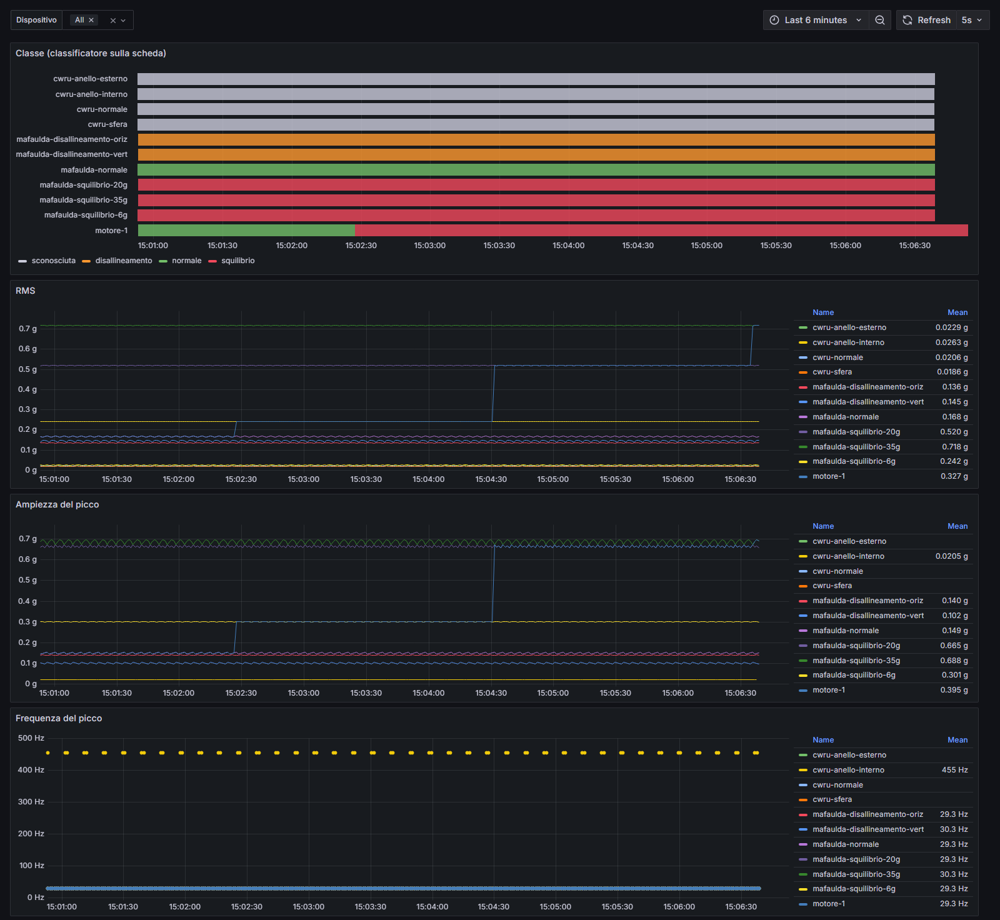

# vibration-monitor

**A machine vibration monitor, end to end: ESP32 firmware with FreeRTOS, an on-device FFT and a small fault classifier, MQTT, TimescaleDB and Grafana, fed by a real sensor or by public fault datasets, and an LLM agent that answers questions about the machines.**

[](https://github.com/davidecinelli26/vibration-monitor/actions/workflows/ci.yml)


[](LICENSE)



An ESP32 reads an MPU-6050 accelerometer 1000 times a second. Every 1024 samples it computes the RMS and the spectrum of the vibration, runs a small classifier (healthy, imbalance, misalignment, or unknown), and it publishes one small JSON message over MQTT. A Python service stores the messages in TimescaleDB, and Grafana plots them.

The same pipeline can be fed without hardware. A replay program reads recordings of healthy and faulty machines from two public datasets (CWRU and MAFAULDA), reduces them to what the 1 kHz sensor would see, and publishes the same JSON on the same topics. That shows what a cheap sensor can and cannot detect. The answer turned out to be less obvious than expected; see [Results](#results).

An agent answers questions about the machines ("is anything behaving strangely?") through an MCP server with read-only tools on the database. It runs on a local model or a hosted one, and an evaluation measures how well each model does. A watcher uses the same tools to send an alert on Telegram when a machine changes.

**Status: work in progress.** Not yet tested on a real board and a real machine: so far the firmware runs in a simulator and the data come from the datasets.

## Author

[Davide Cinelli](https://github.com/davidecinelli26). A personal project, built while learning embedded programming. Comments and identifiers in the code are in Italian.

## How it works

```text
MPU-6050 ──I2C──► ESP32 ──WiFi/MQTT──► Mosquitto ──► ingestor (Python) ──► TimescaleDB ◄── Grafana
                                           ▲                                    ▲
             replay (Python, CWRU + MAFAULDA) ┘                MCP server (read-only)
                                                                                ▲
                                                               agent (LLM, local or hosted)
```

| Folder | What | Tools |
|---|---|---|
| [`firmware/`](firmware) | ESP32 firmware: sampling, analysis, MQTT | PlatformIO, Arduino core 3, FreeRTOS, Wokwi |
| [`ingestor/`](ingestor) | MQTT → TimescaleDB | Python, paho-mqtt, psycopg, uv |
| [`replay/`](replay) | publishes the public datasets as if they were sensors | Python, numpy, scipy, uv |
| [`agente/`](agente) | MCP server, agent loop, evaluation | Python, MCP SDK, OpenAI-compatible client, Ollama |
| [`modello/`](modello) | feasibility study, training and export of the on-device classifier | Python, scikit-learn |
| [`infra/`](infra) | broker, database, dashboard | Docker Compose: Mosquitto, TimescaleDB, Grafana |

The parts only talk through MQTT and SQL, so any of them can be swapped: the replay stands in for the board, and the board does not know who reads its data.

### Firmware

- A hardware timer fires every 1 ms. Its interrupt does no work: it only wakes a high-priority FreeRTOS task. The task reads the sensor over I2C and puts the raw sample in a queue. I2C cannot run inside an interrupt, because the Wire driver blocks on semaphores.
- The main loop takes 1024 samples from the queue (about 1 s) and computes the RMS without the mean, so gravity is removed, plus an FFT of its own (radix-2, in place) and the highest peak.
- Two counters make data loss visible instead of silent: `saltati` (timer ticks the reader missed) and `persi` (samples dropped because the queue was full). The queue holds 512 samples. That is enough for the analysis (about 380 ms in the simulator) and the MQTT publish. The MQTT connection is opened before sampling starts, because the first connect alone used to drop about 116 samples.
- The same window also goes to the classifier: the energy in 16 frequency bands (Hann window) plus the variance, standardized, then a logistic regression with 3 classes. The model is about 90 numbers in a C header, generated by [`modello/esporta.py`](modello/esporta.py). If any input is more than 6 standard deviations away from the training data, the answer is `sconosciuta` (unknown) instead of a confident guess. See [On-device classifier](#on-device-classifier).
- Message: `{"dispositivo":"esp32-1","rms_g":0.2121,"picco_hz":49.8,"picco_g":0.2806,"persi":0,"saltati":0,"classe":"sconosciuta","confidenza":0.00}`. Peaks below 0.02 g are sent as `null`.
- Built with the [Wokwi](https://wokwi.com) simulator in VS Code. Wokwi has no vibrating MPU-6050, so the firmware adds a synthetic 50 Hz, 0.3 g vibration when `SIMULA_VIBRAZIONE` is 1.

### Replay

The replay applies the same analysis as the firmware (the tests check it gives the same numbers on the same signal), and the same classifier, read from the firmware's own header. It sends one window per recording every 1.024 s and starts again when a recording ends. It also plays `motore-1`, a machine that breaks while you watch: healthy, then imbalance with 6, 20 and 35 g, about two minutes each.

### Agent

- **MCP server** ([`agente/server.py`](agente/server.py)) with four tools: `elenca_dispositivi` (machines and their last message), `stato` (one machine over time, at most 12 intervals), `anomalie` (machines whose RMS in the last 5 minutes is at least 1.5 times the hour before, with a TimescaleDB query) and `sensori` (machines whose sensor lost samples in the last hour; the firmware's counters never reset, so it counts how much they grew). The tools also return the class from the board. The instructions carry the domain rules, including what the sensor cannot see and how far to trust the class.
- **Read-only by construction.** The server connects as a database role that has only `SELECT`, runs every transaction read-only and stops any query after 5 s. A wrong query from the model cannot change or block anything.
- **Agent loop** ([`agente/agente.py`](agente/agente.py)): the model gets the question and the tools; when it asks for a tool, the loop runs it on the MCP server and sends the result back, for at most 8 steps. It talks the OpenAI-compatible API, so the same code runs on Ollama or on a hosted service.
- **Telegram alerts** ([`agente/sorveglia.py`](agente/sorveglia.py)): every minute it runs the same queries as `anomalie` and `sensori`. The queries decide whether to alert, not the model: a threshold is wrong in the same way every time, a model is not, and calling one every minute would cost money. The model only writes the alert, after looking at the machines with the tools. If it does not answer, the alert still goes out with the raw numbers. The same finding (for example an anomaly on `motore-1`) is sent at most once an hour. An alert written by gpt-oss-120b on the evaluation scenario:

  > motore‑1: dall'ora 15:10 fino a 16:10 l'RMS è passato da 0,168 g a 0,52 g (rapporto ≈ 3,1) mantenendo il picco a ≈ 29,3 Hz, tipico della velocità di rotazione (≈ 29,5 giri/s); la classe "squilibrio" indica un possibile squilibrio da verificare con un controllo meccanico.
  > motore‑2: dal 16:05 il sensore ha perso 37 campioni, perciò i dati recenti sono meno affidabili; è consigliabile controllare il collegamento o la calibrazione del sensore.
- **Evaluation** ([`agente/valutazione.py`](agente/valutazione.py)): a fixed scenario in its own database (one machine develops an imbalance, one sensor starts losing samples), 11 questions and regex checks on what each answer must and must not say. Four of the questions were never used to tune the instructions or the tools; their score is the honest one. When a change was made after looking at one of them, that question moved to the tuning set and a new one took its place.

Two things the evaluation taught, that held for every model: a long tool result pushed the instructions out of a small model's 4096-token context (so `stato` returns at most 12 rows), and a model given a parameter it could misuse did misuse it (so `anomalie` takes none).

## Run it

You need Docker, [uv](https://github.com/astral-sh/uv) and, for the firmware, VS Code with PlatformIO and the Wokwi extension.

```bash
# 1. broker, database and Grafana
cd infra && docker compose up -d

# 2. store the measurements
cd ../ingestor && uv run python ingestor.py

# 3a. without hardware: download the data once (a few minutes), then replay it
cd ../replay && uv run python scarica_dati.py && uv run python replay.py

# 3b. or the firmware in the simulator: open firmware/ in VS Code,
#     build with `pio run -e esp32`, then F1 → "Wokwi: Start Simulator"

# 4. ask the agent (needs Ollama with `ollama pull qwen2.5:7b`)
cd ../agente && uv run python agente.py "C'è qualche macchina che si sta comportando in modo strano?"

# 5. compare models; hosted ones read their keys from agente/.env (never committed)
uv run --env-file .env python valutazione.py qwen2.5-7b groq-gpt-oss-120b

# 6. alerts on Telegram: a bot from @BotFather, TELEGRAM_TOKEN and TELEGRAM_CHAT_ID in agente/.env
#    (without them the alerts are only printed)
uv run --env-file .env python sorveglia.py
```

Then open the dashboard at http://localhost:3000/d/vibrazioni: the class of each machine over time, RMS, peak amplitude and frequency, and the board's lost-sample counters.

To retrain the classifier after changing the features: `cd modello && uv run python studio.py` (cross-validation) and `uv run python esporta.py` (writes `firmware/lib/classificatore/modello.h` and the test examples). The speed test: `uv run python velocita.py --scarica` (reads 5.8 GB once, keeps about 30 MB).

Tests:

```bash
cd firmware && pio test -e native     # 15 tests: sensor decoding, analysis, JSON, classifier = Python
cd ingestor && uv run pytest -q       # 6 tests: message parsing
cd replay && uv run pytest -q         # 13 tests: analysis, classes of the real data, motore-1 scenario
cd agente && uv run pytest -q         # 17 tests: MCP tools against a temporary table (needs the database), alert cooldown
```

The passwords in `infra/` are for local development only. The database and Grafana listen on 127.0.0.1, and Grafana has no login.

## Results

The MPU-6050 accelerometer outputs at most 1000 samples a second. Nothing above 500 Hz can be seen. The replay measures what that costs.

**CWRU bearing faults are almost invisible at 1 kHz.** Bearing defects show up mostly at kHz frequencies. In the original recordings (drive-end accelerometer, 0 HP, 0.007" faults), most of the vibration is above 500 Hz:

| Recording | RMS, full band | RMS below 500 Hz | Lost |
|---|---|---|---|
| normal | 0.073 g | 0.021 g | 71% |
| inner race | 0.291 g | 0.027 g | 91% |
| ball | 0.139 g | 0.019 g | 86% |
| outer race | 0.669 g | 0.024 g | 96% |

At full bandwidth a faulty bearing vibrates 2 to 9 times more than a healthy one. Below 500 Hz they all sit around 0.02 g. Each fault still keeps a small, stable peak (360, 455, 419 and 449 Hz). These peaks belong to that test rig, not to textbook fault frequencies.

**MAFAULDA imbalance is clearly visible; misalignment is not.** At about 29.5 revolutions per second (underhang radial accelerometer):

| Recording | RMS | Peak |
|---|---|---|
| normal | 0.168 | 29.3 Hz, 0.15 |
| imbalance 6 g | 0.242 | 29.3 Hz, 0.30 |
| imbalance 20 g | 0.520 | 29.3 Hz, 0.67 |
| imbalance 35 g | 0.718 | 30.3 Hz, 0.67 |
| horizontal misalignment 2.0 mm | 0.136 | 29.3 Hz, 0.14 |
| vertical misalignment 1.90 mm | 0.145 | 30.3 Hz, 0.11 |

Imbalance shakes the shaft once per turn, so the peak sits at the rotation speed and grows with the added mass. Misalignment was not separable from the healthy machine with RMS and the 1×, 2× and 3× harmonics, on any of the three axes. That is the motivation for a model that looks at the whole spectrum.

Two notes on MAFAULDA. The dataset page says 50 kHz, but the file names (the rotation speed) only match the tachometer pulses at 51.2 kHz. 51.2 kHz is also the rate of the NI 9234 board used to record it, so the replay uses 51.2 kHz; at 50 kHz every frequency would be 2% low. The page does not state the unit of the values, so they are used as they are; comparisons between recordings do not depend on it.

### On-device classifier

[`modello/studio.py`](modello/studio.py) uses the 72 MAFAULDA recordings near 30 revolutions per second (4 healthy, 28 imbalance, 40 misalignment), cut into 576 windows of 1024 samples at 1 kHz, as the board sees them. Each window becomes a feature vector, and a logistic regression is scored with balanced accuracy. Recordings are never split between training and test: windows of the same file look alike, and mixing them would inflate the score.

| Features per window | Whole files held out (4 folds) | **Whole severities held out** |
|---|---|---|
| What the firmware sent before: RMS, peak Hz, peak amplitude (3) | 0.73 | 0.52 |
| **16 band energies + RMS, radial axis (17)** | 0.99 | **1.00** |
| The same on 3 axes (51) | 0.99 | 0.94 |

"Whole severities held out" means, for example, that the model never saw the 1.5 mm misalignment and still recognizes it. One axis works better than three: with more inputs the model also learns details that do not repeat.

What to keep in mind:

- **Imbalance** is recognized from the 0–31 Hz band (the rotation speed) and the RMS, as the physics says.
- **Healthy vs misalignment** is decided by high bands: the healthy machine has about 4 times more energy at 280–400 Hz, misalignment more at 440–500 Hz. These are not the textbook frequencies (twice the rotation speed). All 4 healthy recordings come from the same session, so the model may be recognizing that session rather than the absence of misalignment. The speed test below makes this less likely: trained on all 49 healthy recordings (12 to 62 revolutions per second), the model still recognizes 91% of healthy windows at speeds it never saw.
- **Outside MAFAULDA the class means nothing**, and a logistic regression does not know that: on the CWRU bearings it said "misalignment" with 100% confidence. The fix is the distance check: training windows are at most 5 standard deviations from the mean, CWRU windows 13 to 22, the simulator's synthetic sine 64. Above 6 the board answers `sconosciuta`, and the tests check this for CWRU and for the sine.
- **The model on the board only knows one speed.** [`modello/velocita.py`](modello/velocita.py) runs it on all 880 MAFAULDA recordings: at speeds other than 28–32 revolutions per second it is right on only 66% of the windows, it calls most imbalances misalignment, and the distance check catches just 6%. A speed change moves the bands without moving them far from the training data. Trained on all speeds and tested on bands of 5 revolutions per second left out one at a time, balanced accuracy is 0.85: 0.88–0.95 above 20 revolutions per second, 0.53–0.67 below, where the vibration is small. The board keeps the 30 Hz model: with all speeds, the distance check would let some CWRU windows through (minimum distance 3.7 instead of 13).
- On a real machine with a real MPU-6050 the model has to be retrained: the units, the mounting and the machine are all different.

The model is about 90 numbers (350 bytes) and the inference is a few hundred multiplications on top of the FFT the firmware already does. The native tests check that the C code gives the same features (within 0.001) and the same probabilities (within 0.0001) as Python on real windows of each class.

### Agent: which model

Free models only: four local ones on Ollama (laptop RTX 4050, 6 GB) and four on free hosted tiers (Groq, Google AI Studio), November 2026. One run each, temperature 0.

| Model | Where | Tuning questions (30 checks) | Unseen questions (12 checks) | s / question |
|---|---|---|---|---|
| qwen3.8 27B | Groq | 30 | **12** | 26 |
| gpt-oss-120b | Groq | 30 | 11 ¹ | 20 |
| gemini-flash-lite | Google | 30 | 11 | 6 |
| gpt-oss-20b | Groq | 30 | 10 | 16 |
| qwen3 8B | local | 30 | 9 | 68 |
| llama3.1 8B | local | 28 | 8 | 10 |
| granite3.3 8B | local | 16 | 8 | 19 |
| qwen2.5 7B | local | 28 | 5 | 10 |

¹ One question lost to an HTTP 400 from Groq ("the model generated output that could not be parsed", a malformed tool call), counted as failed.

How to read it:

- The instructions were tuned on qwen2.5 7B with the tuning questions, so most models score full marks there. The unseen column is the one that compares models, and with 12 checks a difference of one or two is noise.
- "Are there problems with the sensors?" used to be the question almost every model got wrong: no tool reported lost samples, so the models answered from `anomalie`, which only looks at RMS. That was a missing tool, not a weak model. With `sensori` every model except granite gets it right; since the tool was designed by looking at those answers, the question now counts as tuning.
- Locally, qwen3 8B is the most accurate but its reasoning makes it about 7 times slower than qwen2.5 7B. Hosted, qwen3.8 27B got every check right this time and gpt-oss-120b lost one only to an API error; across the runs so far the two are the most reliable, and the free tiers' rate limits and occasional errors are the price.
- The unseen questions are where the hosted models pull away. The small local ones mostly fail by not calling a tool at all (answering "should I stop motore-1?" or "can I trust motore-2's data?" from nothing) or by inventing data for a machine that does not exist. qwen2.5 7B, on which the instructions were tuned, is the weakest on unseen questions: tuning on one model does not transfer as well as it seems.

## Data

The datasets are not in this repository. `replay/scarica_dati.py` downloads them from the original sources:

- **CWRU**: Case Western Reserve University Bearing Data Center, https://engineering.case.edu/bearingdatacenter
- **MAFAULDA**: Machinery Fault Database, Federal University of Rio de Janeiro, https://www02.smt.ufrj.br/~offshore/mfs/page_01.html
